  
  
  

  

  

  

  

<picture>
  <source media="(prefers-color-scheme: dark)" srcset="https://raw.githubusercontent.com/HimeshGunathilaka/HimeshGunathilaka/output/snake-dark.svg" />
  <source media="(prefers-color-scheme: light)" srcset="https://raw.githubusercontent.com/HimeshGunathilaka/HimeshGunathilaka/output/snake.svg" />
  
</picture>

  

Every panel on this page is a single SVG — fonts, icons and animation included. <a href="./assets">Peek at the source.</a>

