<a href="https://himeshgunathilake.dev/">
  
</a>

<p align="center">
  <a href="https://himeshgunathilake.dev/"></a>
  <a href="https://linkedin.com/in/himesh-gunathilaka-bb4818258"></a>
  <a href="mailto:himeshgunathilaka99@gmail.com"></a>
</p>

<br />

I'm a frontend-focused software engineer from Sri Lanka. I obsess over the details most people only *feel* — the 100 ms that makes a tap feel instant, the empty state nobody designed, the layout that still holds at 320 px — and I care just as much about the architecture underneath, so the UI stays fast and easy to change.

Right now I'm leading mobile delivery on **Scolaris GO** at Rightmo Web Solution, and building a few products of my own on the side.

> [!TIP]
> The header, project cards and footer on this page are pure SVG + CSS animation — no exported images, no GIFs. [Peek at the source.](./assets)

## Selected work

<p align="center">
  <a href="https://himeshgunathilake.dev/"></a>
  <a href="https://himeshgunathilake.dev/"></a>
</p>
<p align="center">
  <a href="https://himeshgunathilake.dev/"></a>
  <a href="https://himeshgunathilake.dev/"></a>
</p>

## Toolkit

**Where I live** — frontend & mobile


**What I build on** — backend, data & infrastructure


Plus React Native, Expo, MapLibre GL JS, PostGIS and Drizzle wherever the problem calls for them.

## How I build

```ts
const himesh = {
  role: "Frontend-focused Software Engineer",
  basedIn: "Sri Lanka 🇱🇰",
  shipsTo: ["web", "iOS", "Android", "macOS"],

  obsessedWith: [
    "perceived performance",
    "motion that means something",
    "component architecture that scales",
  ],

  principles: [
    "Simplicity over cleverness.",
    "Measure first, optimise second.",
    "Reusable components, not copy-paste.",
    "Real user value over features that only look impressive.",
    "Sometimes the best engineering is knowing what not to build.",
  ],

  currentlyExploring: ["AI-assisted engineering", "macOS system tooling", "performance"],
} as const;
```

## Contributions

<picture>
  <source media="(prefers-color-scheme: dark)" srcset="https://raw.githubusercontent.com/HimeshGunathilaka/HimeshGunathilaka/output/snake-dark.svg" />
  <source media="(prefers-color-scheme: light)" srcset="https://raw.githubusercontent.com/HimeshGunathilaka/HimeshGunathilaka/output/snake.svg" />
  
</picture>

<br />
<br />

<a href="mailto:himeshgunathilaka99@gmail.com">
  
</a>
